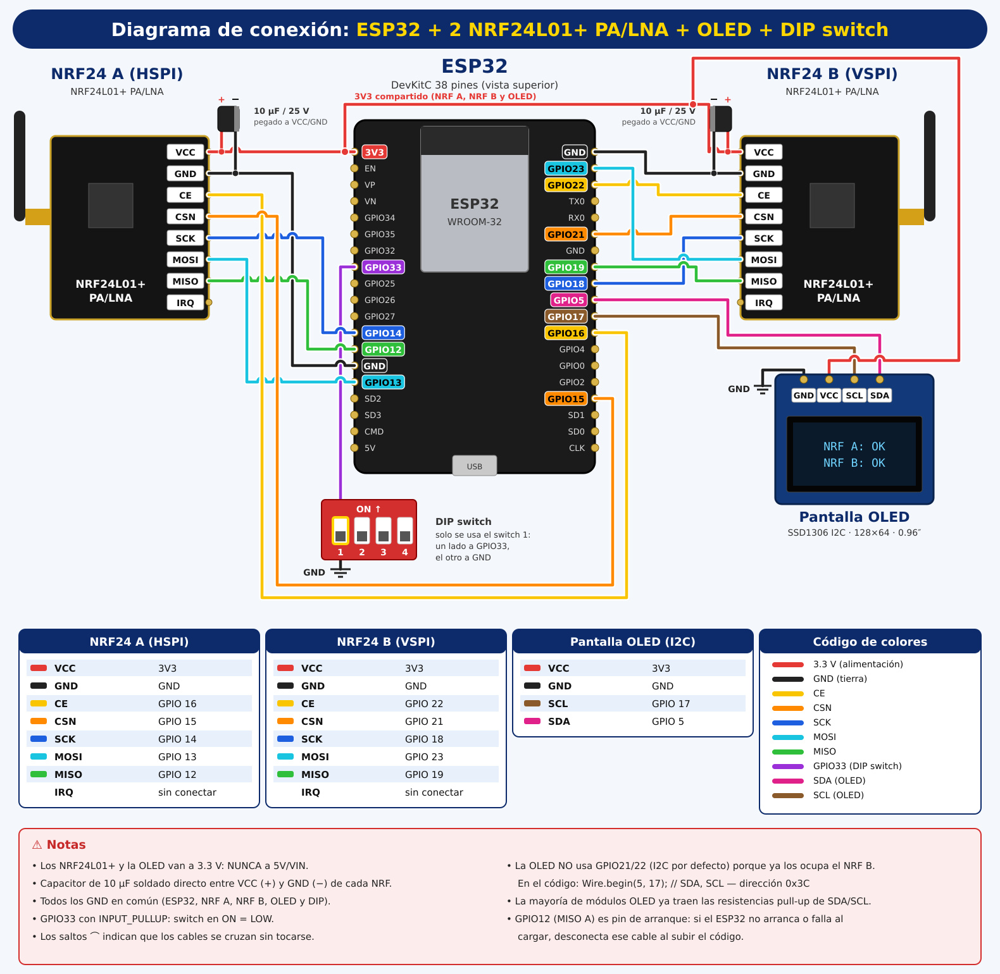

# ESP32-NRF24-OLED

Proyecto basado en ESP32 y módulos NRF24L01, con una pantalla OLED SSD1306 de 128x64 píxeles para mostrar información del sistema en tiempo real.

Esta versión parte de un proyecto existente y añade una interfaz visual mediante OLED, además de documentación propia del montaje y de las modificaciones realizadas por el equipo.

## Características

- ESP32 como microcontrolador principal.
- Dos módulos NRF24L01.
- Uso de los buses HSPI y VSPI.
- DIP switch para seleccionar entre modos del programa.
- Pantalla OLED SSD1306 128x64.
- Visualización del modo seleccionado.
- Visualización de los canales utilizados por los módulos NRF24L01.
- Comunicación I2C para la pantalla OLED.
- Documentación del circuito y de las modificaciones realizadas.

## Componentes

- 1 ESP32.
- 2 módulos NRF24L01.
- 1 pantalla OLED SSD1306 de 0.96 pulgadas, 128x64.
- 1 DIP switch.
- 2 capacitores de 10 µF / 25 V.
- Placa para montaje.
- Cables y conectores.

## Estructura del repositorio

```text
ESP32-NRF24-OLED/
│
├── firmware/
│   └── ESP32_NRF24_OLED/
│       └── ESP32_NRF24_OLED.ino
│
├── docs/
│   ├── diagrama_conexion.png
│   └── oled_ssd1306.md
│
├── README.md
├── CREDITS.md
├── CHANGELOG.md
└── LICENSE
```

## Código principal

El código del proyecto se encuentra en:

```text
firmware/ESP32_NRF24_OLED/ESP32_NRF24_OLED.ino
```

## Pantalla OLED

La pantalla utilizada es una OLED SSD1306 con comunicación I2C.

Conexiones utilizadas:

| OLED | ESP32 |
|---|---|
| GND | GND |
| VCC | 3.3V |
| SDA | GPIO 5 |
| SCL | GPIO 17 |

La dirección I2C configurada es:

```text
0x3C
```

Más información:

```text
docs/oled_ssd1306.md
```

## Librerías necesarias

Para compilar el proyecto en Arduino IDE se utilizan:

- RF24
- ezButton
- Adafruit GFX Library
- Adafruit SSD1306
- Wire
- SPI

## Diagrama de conexión



## Créditos

Este proyecto está basado en el trabajo original de:

**smoochiee**

Repositorio original:

https://github.com/smoochiee/Bluetooth-jammer-esp32

El código base utilizado para el control del ESP32 y los módulos NRF24L01 proviene de dicho proyecto.

Esta versión añade modificaciones propias, principalmente:

- Integración de pantalla OLED SSD1306.
- Visualización de información del sistema.
- Adaptación de pines para comunicación I2C.
- Documentación adicional.
- Diagrama de conexión.
- Organización del proyecto dentro de este repositorio.

Para más información consultar:

```text
CREDITS.md
```

## Licencia

Este proyecto conserva la licencia **GNU General Public License v3.0 (GPL-3.0)** utilizada por el proyecto original.

Consulta el archivo:

```text
LICENSE
```

## Aviso

Este proyecto se documenta con fines educativos y de laboratorio. Las pruebas de radiofrecuencia deben realizarse únicamente en entornos controlados y respetando la normativa aplicable.
